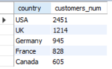
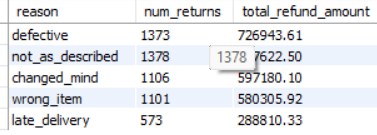
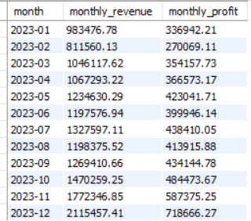
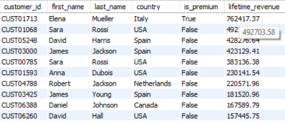
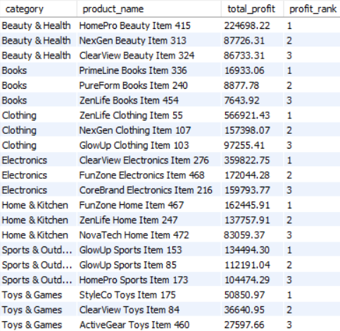

# E-Commerce SQL Analysis

This is my SQL practice project. I took an e-commerce dataset and wrote queries in MySQL to answer some basic business questions: how sales change over time, who the best customers are, why products get returned and which products might run out of stock.

## Dataset

I downloaded the dataset from Kaggle: [Global E-Commerce & Supply Chain Database](https://www.kaggle.com/datasets/parsakh/global-e-commerce-and-supply-chain-database?select=returns.csv) by Parsa Khavarinejad.

It has 8 CSV files (all of them are in the `data` folder):

- `transactions` (100,000 rows): every order with revenue, cost, profit and status
- `customers` (8,000 rows): country, age, premium or not
- `products` (500 rows): category, brand, price, cost
- `returns` (7,126 rows): return reason and refund amount
- `inventory` (500 rows): stock, reorder point, supplier lead time
- `supplier_costs` (998 rows): supplier prices and reliability
- `price_history` (18,000 rows): monthly prices and units sold
- `marketing_spend` (216 rows): monthly spend per channel

An order can be `completed`, `refunded` or `cancelled`. When I talk about revenue or profit I only count `completed` orders.

## Main results

- Revenue did not grow: about $15.5M in each of 2022, 2023 and 2024.
- Sales go up every November and December and drop by more than half in January.
- The profit margin stays around 33-34% every month.
- Refunds cost $3.71M, and most of the reasons are things the company can fix (defective items, not as described, wrong item).
- 68 active products could run out of stock before the supplier can deliver.

## Queries

All my queries are in the `sql` folder, split by difficulty (`level1_easy.sql`, `level2_medium.sql`, `level3_hard.sql`, `level4_expert.sql`). The results are in the `results` folder. Below are the ones I liked most.

---

### 1. Top 5 countries by number of customers

```sql
SELECT country,
       COUNT(*) AS customers_num
FROM ecom.customers
GROUP BY country
ORDER BY customers_num DESC
LIMIT 5;
```

| country | customers_num |
|---|---|
| USA | 2,451 |
| UK | 1,214 |
| Germany | 945 |
| France | 828 |
| Canada | 605 |



**What I found:** The USA has about 31% of all customers (2,451 out of 8,000). The top 5 countries together have about 75%.

Full result: [l1_top_5_countries.csv](results/l1_top_5_countries.csv)

---

### 2. Returns by reason

```sql
SELECT reason,
       COUNT(*) AS num_returns,
       ROUND(SUM(refund_amount_usd), 2) AS total_refund_amount
FROM ecom.returns
GROUP BY reason
ORDER BY total_refund_amount DESC;
```

| reason | num_returns | total_refund_amount |
|---|---|---|
| defective | 1,758 | 931,699.99 |
| not_as_described | 1,793 | 894,772.28 |
| changed_mind | 1,451 | 774,882.22 |
| wrong_item | 1,395 | 738,439.06 |
| late_delivery | 729 | 374,422.70 |



**What I found:** Refunds add up to about $3.71M. Defective items (25%) and "not as described" (24%) cost the most. Only "changed mind" (21%) is the customer's choice, so the rest could be reduced with better quality checks and better product descriptions.

Full result: [l1_returns_by_reason.csv](results/l1_returns_by_reason.csv)

---

### 3. Monthly revenue and profit in 2023

```sql
SELECT DATE_FORMAT(date, '%Y-%m') AS month,
       SUM(revenue_usd) AS monthly_revenue,
       SUM(profit_usd) AS monthly_profit
FROM ecom.transactions
WHERE status = 'completed'
  AND date BETWEEN '2023-01-01' AND '2023-12-31'
GROUP BY month
ORDER BY month ASC;
```

| month | monthly_revenue | monthly_profit |
|---|---|---|
| 2023-01 | 983,476.78 | 336,942.21 |
| 2023-02 | 811,560.13 | 270,069.11 |
| 2023-03 | 1,046,117.62 | 354,157.73 |
| 2023-04 | 1,067,293.22 | 366,573.17 |
| 2023-05 | 1,234,630.29 | 423,041.71 |
| 2023-06 | 1,197,576.94 | 399,946.14 |
| 2023-07 | 1,327,597.11 | 438,410.05 |
| 2023-08 | 1,198,375.52 | 413,915.88 |
| 2023-09 | 1,269,410.66 | 434,144.78 |
| 2023-10 | 1,470,259.25 | 484,473.67 |
| 2023-11 | 1,772,346.85 | 587,375.25 |
| 2023-12 | 2,115,457.41 | 718,666.27 |



**What I found:** In 2023 the revenue was $15.49M and the profit $5.23M, so the margin is about 34%. December was the best month and February the worst. The margin stays between 33% and 34.5% in every month.

Full result: [l2_monthly_revenue_2023.csv](results/l2_monthly_revenue_2023.csv)

---

### 4. Top 10 customers by total revenue

```sql
SELECT c.customer_id,
       c.first_name,
       c.last_name,
       c.country,
       c.is_premium,
       SUM(t.revenue_usd) AS lifetime_revenue
FROM ecom.customers c
JOIN ecom.transactions t
  ON c.customer_id = t.customer_id
WHERE t.status = 'completed'
GROUP BY c.customer_id, c.first_name, c.last_name, c.country, c.is_premium
ORDER BY lifetime_revenue DESC
LIMIT 10;
```

| customer_id | first_name | last_name | country | is_premium | lifetime_revenue |
|---|---|---|---|---|---|
| CUST01713 | Elena | Mueller | Italy | 1 | 762,417.37 |
| CUST01068 | Sara | Rossi | USA | 0 | 492,703.58 |
| CUST05248 | David | Harris | Spain | 0 | 428,276.64 |
| CUST03000 | James | Jackson | Spain | 0 | 423,129.41 |
| CUST00785 | Sara | Rossi | USA | 0 | 383,136.38 |
| CUST01593 | Anna | Dubois | USA | 0 | 230,141.54 |
| CUST04788 | Robert | Jackson | Netherlands | 0 | 220,571.96 |
| CUST03425 | James | Young | Spain | 0 | 181,520.96 |
| CUST06388 | Daniel | Johnson | Canada | 0 | 167,589.79 |
| CUST06260 | David | Hall | USA | 0 | 157,445.75 |



**What I found:** The best customer spent $762K, while the average customer spent about $5.8K. Even so, the top 10 customers are only 7.4% of all revenue. Only one of the top 10 is a premium customer.

Full result: [l2_top_10_customers.csv](results/l2_top_10_customers.csv)

---

### 5. Top 3 products by profit in each category

```sql
WITH product_profit AS (
    SELECT p.category,
           p.product_id,
           p.name AS product_name,
           SUM(t.profit_usd) AS total_profit,
           ROW_NUMBER() OVER (
               PARTITION BY p.category
               ORDER BY SUM(t.profit_usd) DESC
           ) AS profit_rank
    FROM ecom.transactions t
    JOIN ecom.products p
      ON t.product_id = p.product_id
    WHERE t.status = 'completed'
    GROUP BY p.category, p.product_id, p.name
)
SELECT category,
       product_name,
       total_profit,
       profit_rank
FROM product_profit
WHERE profit_rank <= 3
ORDER BY category, profit_rank;
```

The full result has 21 rows (7 categories x 3). Here are two of them:

| category | product_name | total_profit | profit_rank |
|---|---|---|---|
| Beauty & Health | HomePro Beauty Item 415 | 224,698.22 | 1 |
| Beauty & Health | NexGen Beauty Item 313 | 87,726.31 | 2 |
| Beauty & Health | ClearView Beauty Item 324 | 86,733.31 | 3 |
| Clothing | ZenLife Clothing Item 55 | 566,921.43 | 1 |
| Clothing | NexGen Clothing Item 107 | 157,398.07 | 2 |
| Clothing | GlowUp Clothing Item 103 | 97,255.41 | 3 |



**What I found:** The top 3 products make between 12% and 30% of the profit of their category, so the profit is not concentrated in one product. In Clothing, the best product makes 3.6 times more profit than the second one.

Full result: [l3_top3_profit_per_category.csv](results/l3_top3_profit_per_category.csv)

---

### 6. Month-over-month revenue growth

```sql
WITH monthly AS (
    SELECT DATE_FORMAT(date, '%Y-%m') AS month,
           SUM(revenue_usd) AS revenue
    FROM ecom.transactions
    WHERE status = 'completed'
    GROUP BY DATE_FORMAT(date, '%Y-%m')
)
SELECT month,
       revenue,
       ROUND(LAG(revenue) OVER (ORDER BY month), 2) AS prev_month_revenue,
       ROUND((revenue - LAG(revenue) OVER (ORDER BY month)) * 100.0
             / LAG(revenue) OVER (ORDER BY month), 2) AS mom_growth_pct
FROM monthly
ORDER BY month;
```

The result has 36 months. Here are 4 of them (the end of 2022 and January 2023):

| month | revenue | prev_month_revenue | mom_growth_pct |
|---|---|---|---|
| 2022-10 | 1,372,470.44 | 1,245,683.86 | 10.18 |
| 2022-11 | 1,825,784.60 | 1,372,470.44 | 33.03 |
| 2022-12 | 2,000,165.72 | 1,825,784.60 | 9.55 |
| 2023-01 | 983,476.78 | 2,000,165.72 | -50.83 |

**What I found:** The same thing happens every year: sales grow in November and December and then fall by more than 50% in January (-50.8% in 2023 and -55.2% in 2024). The total revenue per year is almost the same ($15.47M, $15.49M, $15.54M), so the business is not really growing.

Full result: [l3_mom_growth.csv](results/l3_mom_growth.csv)

---

### 7. Products that can run out of stock before the delivery arrives

For this one I made a few assumptions: demand is the average monthly units sold in the last 6 months of the data (July to December 2024), cancelled orders are not counted, and I only look at active products.

```sql
WITH demand AS (
    SELECT product_id,
           SUM(quantity) / 6.0 AS avg_monthly_units
    FROM ecom.transactions
    WHERE status <> 'cancelled'
      AND date >= '2024-07-01' AND date <= '2024-12-31'
    GROUP BY product_id
)
SELECT p.product_id,
       p.name,
       p.category,
       i.stock_units,
       i.reorder_point,
       i.supplier_lead_days,
       ROUND(d.avg_monthly_units, 1)                          AS avg_monthly_units,
       ROUND(i.stock_units / (d.avg_monthly_units / 30.0), 1) AS days_of_cover,
       ROUND(i.supplier_lead_days - i.stock_units / (d.avg_monthly_units / 30.0), 1) AS shortfall_days
FROM ecom.products p
JOIN ecom.inventory i ON i.product_id = p.product_id
JOIN demand d         ON d.product_id = p.product_id
WHERE p.is_active = 1
  AND i.stock_units / (d.avg_monthly_units / 30.0) < i.supplier_lead_days
ORDER BY shortfall_days DESC;
```

The result has 68 products. Here are the first 5:

| product_id | name | category | stock_units | reorder_point | supplier_lead_days | avg_monthly_units | days_of_cover | shortfall_days |
|---|---|---|---|---|---|---|---|---|
| PROD0402 | CoreBrand Beauty Item 402 | Beauty & Health | 3 | 5 | 25 | 13.7 | 6.6 | 18.4 |
| PROD0198 | PrimeLine Electronics Item 198 | Electronics | 3 | 4 | 29 | 8.0 | 11.2 | 17.8 |
| PROD0414 | CoreBrand Sports Item 414 | Sports & Outdoors | 3 | 5 | 25 | 11.7 | 7.7 | 17.3 |
| PROD0268 | NexGen Electronics Item 268 | Electronics | 3 | 4 | 27 | 8.8 | 10.2 | 16.8 |
| PROD0245 | PrimeLine Clothing Item 245 | Clothing | 2 | 4 | 22 | 10.3 | 5.8 | 16.2 |

**What I found:** 68 out of 468 active products would run out of stock before a new delivery arrives. A typical one has about 12 days of stock, but the supplier needs 22 to 29 days. Electronics has the most products at risk (17). Only 34 of the 68 are at or below their reorder point, so using the reorder point alone would miss half of them.

Full result: [l4_stockout_risk.csv](results/l4_stockout_risk.csv)

---

## How to run it

1. Create the database in MySQL: `CREATE DATABASE ecom;`
2. Create the tables using the column names from the CSV files in `data`.
3. Load the CSV files (I used `LOAD DATA INFILE`).
4. Check the number of rows.
5. Run the files from the `sql` folder.

Notes:
- You need MySQL 8.0 or newer, because I use window functions and CTEs.
- Some `discount_pct` values in the CSV look like `0.15000000000000002`. MySQL rounds them to 0.15 and shows a "data truncated" warning when loading. This is not a problem.
- In my database `is_premium` and `is_active` are stored as 1 and 0.

## Tools

MySQL 8.0, MySQL Workbench, Git and GitHub Desktop.

